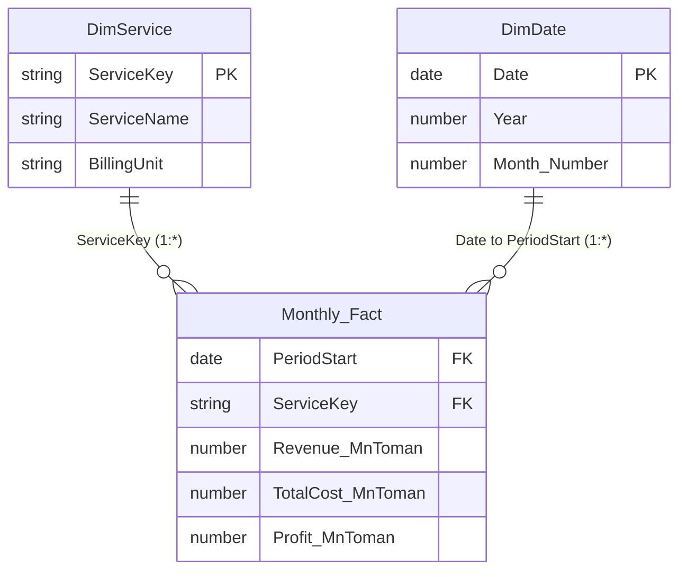

# Power BI data model

## Tables

1. **Monthly_Fact** — `data/Monthly_Fact.csv`; grain: one row per service and month. Use this for financial measures.
2. **DimService** — `data/DimService.csv`; grain: one row per service. Use this for slicers and service labels.
3. **DimDate** — optional DAX calendar table; most useful once real monthly history is appended.

## Relationships

- Relationship `DimService[ServiceKey]` (one) → `Monthly_Fact[ServiceKey]` (many), single-direction filtering from dimension to fact.
- If you create `DimDate`, relate `DimDate[Date]` (one) → `Monthly_Fact[PeriodStart]` (many), single-direction. Since `PeriodStart` is a month-start date, only those date rows will directly match fact rows.
- Set `PeriodStart` to Date type; monetary fields to Decimal Number; `ProfitMarginPct`, `UtilizationPct` and percentage measures to Percentage.
- Hide technical key columns in report view if appropriate. Keep monetary units explicit in measure names or visual titles.

## Grain / limitations

The input contains one illustrative month and two service rows only. It supports a monthly comparison, not a trend analysis. Append one row per service for every additional month, using actual month-start dates. Do not extrapolate this month into a historical series.
